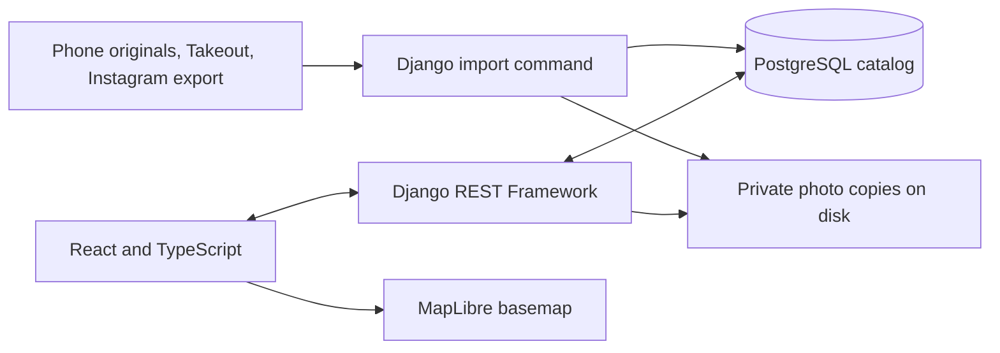

# Pin & Frame app design

**Proposed for review, November 22, 2026**

## What the app does

Pin & Frame is a personal travel journal. Browse trips in order, see their stops on a map, and open a place to find its photos from your phone and Instagram together. A visit appears at its own point on the timeline even if you have been to the same place before.

The first version covers one owner, photos, and a Windows PC workflow. You create a trip, import local photo folders, and confirm where the photos belong. You can correct dates and assignments later. Phone-browser uploads, live tracking, direct social account sync, videos, shared accounts, and deployment are outside this version.

This design assumes PC batch imports and a private, single-owner app. The import entry point is the one product choice to settle before implementation. If you need phone uploads in v1, the ingest and review workflow needs a separate pass.

## Architecture

Use one Django application with Django REST Framework and PostgreSQL. React with TypeScript owns the browser UI. The importer is a Django management command that uses the same database, validation rules, and photo storage as the API. The browser makes same-origin requests through the Vite dev proxy. The app and database bind to loopback for local use.

| Approach | Fit |
| --- | --- |
| Django and DRF with a React UI and local batch command | Chosen. One catalog supports browsing, correcting imports, and rerunning batches. The command handles long-running work outside HTTP. |
| Static JSON catalog and a standalone importer | Works for browsing. Correcting trips or photo assignments requires editing the input and regenerating the catalog. |
| Browser upload with a background worker | Supports importing from a phone. It adds upload handling, job state, and more manual location entry when metadata is missing. |

Start with Python 3.13, Django 5.2 LTS, a compatible DRF release, PostgreSQL 17, Node 24 LTS, React, TypeScript, and Vite. Document a native Windows setup with pinned dependencies and Django ORM migrations. Organize backend code around the catalog and imports. Use ordinary numeric coordinates and a proximity check in Python for the small set of places in a trip. [Django support](https://www.djangoproject.com/download/) · [DRF compatibility](https://www.django-rest-framework.org/) · [PostgreSQL support](https://www.postgresql.org/support/versioning/) · [Node releases](https://nodejs.org/en/about/previous-releases) · [Vite requirements](https://vite.dev/guide/)

## Catalog

| Record | What it stores |
| --- | --- |
| Trip | Title, dates, and an ordered set of visits. |
| Place | A reusable name and map pin you can edit. |
| Visit | A stop on one trip, linked to a place, with a visit date and position in the trip. Returning to a place creates another visit. |
| Photo | A unique content hash, date if known, dimensions, two media keys, and a review state. An approved assignment links it to one visit. |
| Import run | Source type, target trip, progress, and summary of imported, reused, skipped, and failed items. |
| Import item | The source entry, observed dates and coordinates, and any import or matching issue. Successful entries link to a photo, so overlapping sources can retain their provenance. |

Use stable IDs for links and uniqueness constraints for the photo hash and visit position within a trip. Keep observed source values separate from owner corrections. Store an exact timestamp only when its offset is known. Keep an available local date and preserve the source's date precision. A publication timestamp belongs to the source record and can help with review. Galleries sort by available capture date with a stable ID tie-breaker. The trip timeline uses its recorded visit order.

## Import and review

1. **Create the trip.** Add a title and dates in the app. Add known stops up front or add them while reviewing the photos.
2. **Select a source folder.** Run one command per source against a trip. The command reads a folder of phone originals or an extracted Google Takeout or Instagram JSON archive. Support an optional, explicitly chosen date window for full-account exports. Window filters use the available capture date for device and Takeout sources and the publication date for Instagram. Report records with missing dates separately for review.
3. **Read the metadata.** Read EXIF and apply orientation for phone originals. In Takeout, match sidecars across extracted parts using path and filename hints as well as the metadata title. Leave ambiguous matches for review and fall back to file metadata where available. Read Instagram post dates, captions, and optional location for each media item. Check the decoded image format, including when the extension is wrong. [Photo source research](../research/photo-sources-and-gps.md) · [Takeout matcher examples](https://github.com/simulot/immich-go/blob/main/docs/misc/google-takeout.md)
4. **Prepare photos for review.** Support JPEG, PNG, WebP, and HEIC. Generate a WebP thumbnail and display copy targeting 400 px and 2,048 px on the long edge, with embedded metadata stripped. Store them in an app-owned folder outside the repo. Leave the originals in your existing backup. Deduplicate identical bytes across sources using SHA-256. For similar photos with different bytes, let the owner keep both or ignore one. [Pillow-Heif installation](https://pillow-heif.readthedocs.io/en/stable/installation.html)
5. **Confirm the assignment.** Show previews, candidate visits, and the reason for each suggestion. A unique nearby visit can be suggested using GPS. For an Instagram photo with missing GPS, known dates and visits can narrow the choices. Assign one photo or a batch to a visit, create a named stop at a point on the map, correct a date, or leave the item for later. Only approved photos appear in the archive. Reimporting an approved photo preserves its existing assignment and corrections and flags a conflict if the new target trip differs.

Use one import lock and short database transactions. For each decodable photo, write both variants to temporary files and replace them at their final paths before committing their database references. A malformed item gets an error while the batch continues. An interrupted import can be run again from the same folder. Previously committed photos are reused, completed media files can be reused, and partially written files never appear in the app. Restrict media entries referenced by exports to the selected folder. Keep per-item errors useful without exposing absolute paths in the API.

## Browser app and API

- **Archive.** Show a map, a chronological trip list, and a place gallery. Filter by year or trip. Pins, trip selection, and the list share the same selection in the URL so Back works. A place gallery combines visits and can be filtered to one visit. Load thumbnails as needed and fetch the display copy when opened. Support keyboard navigation, and keep the timeline and galleries usable if the map fails.
- **Review.** Show import runs with counts and failed items. Use the same map and photo preview components for review and browsing. Allow batch assignment, individual corrections, and ignoring an item from the review list.
- **Map.** Use MapLibre GL JS with a configurable OpenFreeMap style and attribution. Keep pin coordinates under the owner's control. Named places and visit order are enough to tell the story in v1. [OpenFreeMap setup](https://openfreemap.org/quick_start/)

Use `/api/v1/` for trip and place management, ordered visits, galleries, and import review. Return compact location and count summaries for map pins. Paginate trips, review items, and galleries using DRF with stable ordering. Return media URLs and dimensions in gallery results. Keep source paths, raw GPS observations, and import diagnostics out of browse responses. Share approval and validation rules between API writes and the importer. [DRF pagination](https://www.django-rest-framework.org/api-guide/pagination/)

Use one Django owner account and session authentication with CSRF checks for writes. Apply the same owner check to media as to API requests, including when opening a photo URL directly. Only serve the two generated sizes through the app. Keep credentials, backups, real exports, and generated media outside source control. Use synthetic fixtures in the public repo. [DRF session authentication](https://www.django-rest-framework.org/api-guide/authentication/#sessionauthentication) · [Django file storage](https://docs.djangoproject.com/en/5.2/ref/files/storage/)

## Acceptance checks

| Area | Check |
| --- | --- |
| First trip | Create a trip with two visits, import phone and Instagram photos, approve a batch, select a trip on the map, and open a place gallery. |
| Repeated visits | A place visited twice appears in both trips and shows both sets of photos in its gallery. The trip filter isolates the relevant visit. |
| Metadata | Cover missing GPS, valid coordinates near zero, delayed Instagram posts, an Instagram carousel, Takeout filename collisions, ambiguous timestamps, and a rotated HEIC image. Check that generated media has no embedded GPS. |
| Repeat and interrupted imports | Import overlapping sources and rerun after a partial failure. Check for one gallery photo per exact duplicate, preserved corrections, and no references to partial files. |
| Privacy and browse | Check anonymous API and direct photo access, export paths outside the source folder, pending and ignored photos, stable gallery pagination, keyboard interaction, and map failure. |
| Restore | With imports stopped, back up PostgreSQL and the media directory together. Restore into a clean local setup and browse an imported trip. [PostgreSQL backup](https://www.postgresql.org/docs/17/app-pgdump.html) |

## Proposed pull request stack

| Order | Branch | Review scope |
| --- | --- | --- |
| 1 | `feat/local-app` | Windows setup, Django and PostgreSQL, React and Vite, and owner sign-in. |
| 2 | `feat/travel-catalog` | Trips, places, visits, migrations, and DRF catalog endpoints. |
| 3 | `feat/photo-import` | Local folder import and protected photo copies, then Takeout and Instagram adapters in separate commits. |
| 4 | `feat/import-review` | Import results, photo review and assignment, and related API endpoints. |
| 5 | `feat/travel-viewer` | Map, timeline, and galleries with navigation and fallback states. |
| 6 | `feat/local-acceptance` | End-to-end sample trip, repeat import checks, and local backup and restore instructions. |

Target each child PR at its parent branch, review from the base upward, and retarget the next PR as its parent merges. Keep commits small with one-line subjects and no co-author trailers. Keep docstrings short and close to the behavior they explain. [GitHub stacked pull requests](https://docs.github.com/en/pull-requests/how-tos/create-pull-requests/creating-stacked-pull-requests)

## Decisions for implementation

After design approval, write the implementation plan with the concrete Windows setup, package versions, migration order, API payloads, import command flags, and tests for each PR. Confirm HEIC decoding on Windows with a synthetic fixture and tune image quality and GPS suggestion distance using the first sample trip.
